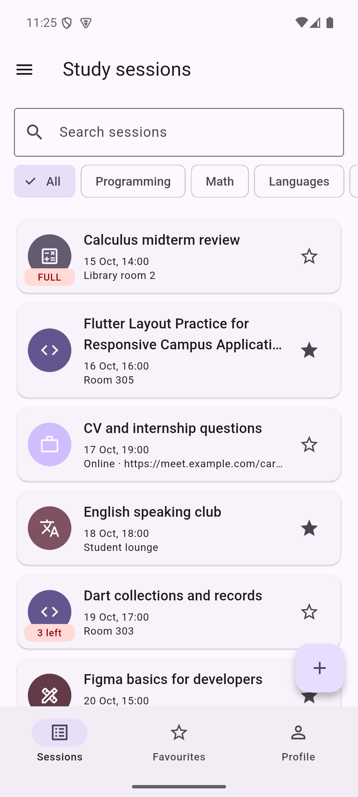
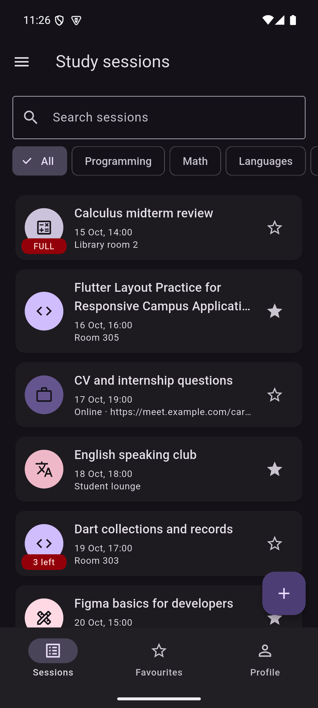
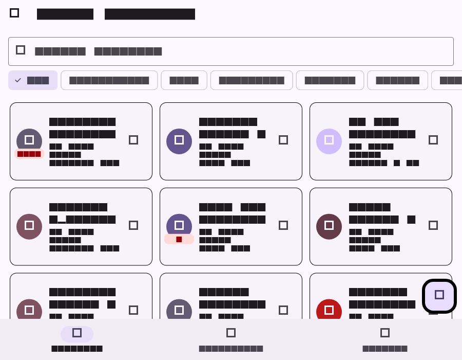

# Study Sessions

Study Sessions is a Flutter app for finding small university study meetings.
Each session has a category, date, place or online link, participant limit,
optional description, favourite state, and a list of participants.

## Screenshots

### Phone — light

### Phone — dark

### Tablet grid

## Decisions

The session list and profile are stored in the shell because all three tabs use
the same data. The detail screen receives callbacks so a join, edit, or delete
is sent back to that single owner. The form returns a `StudySession` through
`Navigator.pop`, which means cancelling the form does not change the list. A
`LayoutBuilder` chooses the grid because the available width matters more than
the physical device name. The form's `PopScope` compares its current controller
values with the values it opened with. Theme mode lives above `MaterialApp` so
the whole application switches together. With the state-management tools from
week 9, I would move the shared list and profile out of the shell widget.
